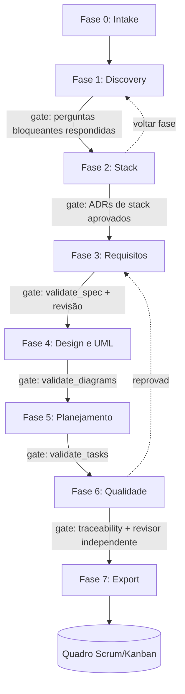

> **Nota de implementação:** este documento é o desenho original. A implementação real difere em um ponto de layout:
> `scripts/`, `templates/`, `stacks/` e `schemas/` ficam dentro de **`harness/`** (ex.: `harness/scripts/validate_spec.py`),
> e as pastas `.sdd/` usam nomes em português. Os comandos são skills em `.claude/skills/sdd-*`. Consulte o `README.md` para o mapa atual.

# SDD Harness: Arquitetura e Organização (v2)

> Harness de **especificação** (não de implementação) que roda dentro de um agente de IA (ex.: Claude Code), versionado no GitHub.
> **Entrada:** um prompt livre descrevendo o sistema (ou a evolução de um sistema existente).
> **Saída:** backlog completo e auditado, pronto para Scrum ou Kanban: épicos, user stories, critérios de aceite, UML, ADRs, tasks, plano de testes, rastreabilidade e export para a ferramenta de quadro.

---

## 1. Princípios

1. **Spec é o produto.** Nenhuma linha de código de aplicação é gerada. O consumidor da spec é uma pessoa (time, PO, QA).
2. **Humano decide, agente propõe.** Toda escolha relevante (stack, escopo, prioridade) passa por um gate de aprovação.
3. **Gates mecânicos antes de gates humanos.** Scripts determinísticos reprovam estrutura quebrada antes de você gastar tempo revisando.
4. **Autor ≠ verificador.** Quem gera um artefato não é quem o audita.
5. **Rastreabilidade total.** Requisito → US → AC → Task → Caso de teste, sempre com IDs estáveis.
6. **Tamanho certo.** A profundidade da spec escala com a complexidade (auto-sizing com limites rígidos).
7. **Intenção original é imutável.** O texto bruto do usuário nunca é reescrito.
8. **Tudo é arquivo em git.** Diff, PR, revisão e histórico de decisões vêm de graça.

---

## 2. O que foi adaptado do SDD original

O material de referência foi desenhado para controlar um agente que **escreve código**. Aqui o consumidor é humano, então:

| Peça do SDD original | Decisão | No harness |
|---|---|---|
| US com ID + "Como/quero/para" | Mantida | Base do backlog |
| BDD + EARS | Mantida | AC em BDD; lógica crítica também em EARS |
| Assumptions / Open Questions | **Reforçada** | Gate bloqueante, com classificação de impacto e dono da resposta |
| `design.md` / `STATE.md` / ADRs | Mantida | Gerados e validados |
| Mermaid | Mantida e expandida | Conjunto completo de UML (seção 8) |
| Auto-sizing | Mantida | Limites rígidos de artefatos por tamanho |
| `tasks.md` atômicas + testes primeiro | **Adaptada** | Task com *Definition of Done* + casos de teste **especificados** (não executados) |
| Mutantes (sensor de discriminação) | **Substituída** | *Adversário de ambiguidade*: agente tenta interpretar cada AC de duas formas; se consegue, o AC volta |
| `check_commit.py` | Descartada | Não há commits de código; vira validação de commits **da spec** (opcional) |
| `LESSONS.md` | Adaptada | Lições sobre **qualidade de especificação** (ambiguidades recorrentes, perguntas que o time sempre faz) |
| `validate_*.py` | Mantida e ampliada | Conjunto de validadores (seção 10) |
| Autor ≠ Verificador | Mantida | Subagentes de revisão com ferramentas somente-leitura |

---

## 3. Fluxo geral



**Regras de navegação**

- É possível **voltar para qualquer fase**. Os artefatos downstream afetados são marcados `stale` automaticamente (seção 9.3), nunca apagados.
- Cada fase termina com: (1) validadores determinísticos, (2) resumo para aprovação humana, (3) atualização do `STATE.md`.
- `/sdd-run` executa fase a fase, parando em cada gate. Cada fase também pode ser chamada isoladamente.

---

## 4. Estrutura do repositório do harness

Separação importante: o **harness** (este repositório, reutilizável) é diferente do **projeto-alvo** (onde `.sdd/` é gerado).

```
sdd-harness/
├── AGENTS.md                     # regras gerais para qualquer agente (+ CLAUDE.md apontando para ele)
├── README.md
├── .claude/
│   ├── skills/                   # uma skill por fase (invocáveis como /comandos)
│   │   ├── sdd-init/SKILL.md
│   │   ├── sdd-intake/SKILL.md
│   │   ├── sdd-discover/SKILL.md
│   │   ├── sdd-stack/SKILL.md
│   │   ├── sdd-spec/SKILL.md
│   │   ├── sdd-design/SKILL.md
│   │   ├── sdd-plan/SKILL.md
│   │   ├── sdd-quality/SKILL.md
│   │   ├── sdd-export/SKILL.md
│   │   ├── sdd-adopt/SKILL.md    # modo evolução: engenharia reversa do sistema existente
│   │   ├── sdd-evolve/SKILL.md   # modo evolução: gerar delta de spec
│   │   ├── sdd-status/SKILL.md
│   │   ├── sdd-back/SKILL.md     # voltar fase e marcar stale
│   │   └── sdd-run/SKILL.md      # orquestrador
│   └── agents/                   # subagentes (contexto isolado)
│       ├── spec-reviewer.md      # verificador independente (somente leitura)
│       ├── ambiguity-adversary.md
│       ├── stack-analyst.md
│       └── legacy-analyst.md     # lê o código existente no modo evolução
├── templates/                    # templates em pt-BR (seção 7)
├── schemas/                      # JSON Schemas: project.yaml, backlog.json, stack-pack
├── stacks/                       # packs de conhecimento por stack (seção 6)
├── scripts/
│   ├── validate_spec.py
│   ├── validate_tasks.py
│   ├── validate_traceability.py
│   ├── validate_diagrams.py
│   ├── validate_state.py
│   ├── validate_stale.py
│   ├── lint_language.py
│   ├── check_sizing.py
│   ├── graph_deps.py             # ciclos + caminho crítico
│   └── export/                   # conversores (seção 12)
├── .github/
│   ├── workflows/validate-spec.yml
│   ├── ISSUE_TEMPLATE/refinamento.yml   # stakeholders respondem open questions
│   └── pull_request_template.md
└── examples/                     # projetos de exemplo (Small, Medium, Large, evolução)
```

> **Dependências:** scripts em Python **apenas com biblioteca padrão** (+ `pyyaml` se necessário). Validação sintática de Mermaid usa `mermaid-cli` quando disponível, com fallback para lint estrutural.

### Estrutura gerada no projeto-alvo

```
.sdd/
├── project.yaml                  # metadados, modo, metodologia, sizing, fase atual, stack, equipe
├── STATE.md                      # estado, decisões, pendências, histórico de gates
├── LESSONS.md                    # lições sobre qualidade de spec
├── GLOSSARIO.md                  # linguagem ubíqua
├── 00-intake/
│   └── raw.md                    # imutável (hash registrado)
├── 01-discovery/
│   ├── contexto.md               # atores, objetivos, métricas, escopo dentro/fora
│   ├── suposicoes.md
│   └── perguntas-abertas.md
├── 02-stack/
│   ├── criterios.md              # o que pesa na decisão (priorização)
│   ├── analise.md
│   └── adr/ADR-001-banco-de-dados.md ...
├── 03-requisitos/
│   ├── spec.md                   # épicos, US, AC, RN, RNF
│   └── compliance.md             # LGPD, PCI-DSS etc., quando aplicável
├── 04-design/
│   ├── design.md
│   ├── diagramas/*.mmd
│   ├── modelo-de-dados.md
│   └── contratos-api.md          # esboço OpenAPI
├── 05-planejamento/
│   ├── tasks.md
│   ├── dependencias.md
│   ├── riscos.md
│   ├── plano-scrum.md            # se metodologia = scrum
│   └── plano-kanban.md           # se metodologia = kanban
├── 06-qualidade/
│   ├── plano-de-testes.md
│   ├── rastreabilidade.md
│   └── relatorio-revisao.md
├── 07-export/
│   ├── backlog.json              # formato canônico
│   └── jira.csv | linear.csv | github-issues.json ...
├── legado/                       # SOMENTE no modo evolução (seção 5.2)
│   ├── baseline.md
│   ├── arquitetura-atual.md
│   ├── inventario.md
│   └── divida-tecnica.md
└── mudancas/                     # SOMENTE no modo evolução
    └── CHG-001-nome/
        ├── intake.md
        ├── delta-spec.md
        ├── delta-tasks.md
        └── impacto.md
```

---

## 5. Modos de operação

### 5.1 Greenfield (sistema novo)

Fluxo completo das fases 0 a 7.

### 5.2 Evolução (sistema existente)

Este modo existia só como pergunta no desenho anterior. Agora é de primeira classe, com dois comandos.

**`/sdd-adopt` (uma vez por sistema): cria a linha de base**

1. O `legacy-analyst` lê o repositório existente (somente leitura) e gera `legado/`:
   - inventário de módulos, entidades, integrações e endpoints;
   - arquitetura *as-is* em Mermaid;
   - stack real detectada (vira ADRs retroativos marcados `status: inferido`);
   - dívida técnica e riscos.
2. Reconstrói uma **spec de baseline** (US/AC retroativas) a partir do comportamento observável, cada item marcado `origem: inferida` e `confianca: alta|media|baixa`.
3. **Gate humano:** você confirma ou corrige as inferências. Sem confirmação, nada do que foi inferido é tratado como verdade.

**`/sdd-evolve` (a cada mudança): gera um delta, não recomeça**

1. Você descreve a mudança ("quero adicionar X"). O texto vai para `mudancas/CHG-NNN/intake.md`.
2. O harness produz um `delta-spec.md` com seções explícitas:
   - `ADICIONADO` (novas US/AC com IDs novos);
   - `MODIFICADO` (mostra antes/depois, mantém o ID);
   - `REMOVIDO` / `DEPRECADO` (o ID nunca é reutilizado).
3. **Análise de impacto** (`impacto.md`): quais US, diagramas, contratos, tasks e testes existentes são afetados; riscos de regressão; necessidade de migração de dados.
4. Gera `delta-tasks.md` incluindo tasks de **teste de regressão** e de **migração/compatibilidade** quando aplicável.
5. Ao aprovar, o delta é **mesclado** na spec principal e os IDs são preservados.

**Regra de ouro:** a stack já existe, então `/sdd-stack` no modo evolução vira *validação de aderência* (a mudança cabe na stack atual? exige nova dependência?). Só abre seleção completa se a mudança exigir uma nova camada.

### 5.3 Metodologia: Scrum e Kanban

Definida em `project.yaml` (`metodologia: scrum | kanban`). Pode ser trocada depois; apenas o planejamento é regenerado, a spec não muda.

| Aspecto | Scrum | Kanban |
|---|---|---|
| Unidade de estimativa | Story points (Fibonacci) | Tamanho P/M/G + limite de dias |
| Limite por task | ≤ 5 pontos (acima disso obriga quebrar) | ≤ 2 dias de trabalho |
| Organização | Sprints com **meta de sprint** | Colunas, **limites de WIP**, classes de serviço |
| Capacidade | Calculada a partir do perfil de equipe | Baseada em *throughput* alvo |
| Priorização | Ordem do backlog + MoSCoW | Classes de serviço (padrão, urgente, data fixa) |
| Saída de planejamento | `plano-scrum.md` | `plano-kanban.md` |
| Ritual apoiado | Refinamento, planning | Refinamento contínuo, política de puxar |

O harness gera **o mesmo backlog base** para ambos; só a camada de planejamento muda.

---

## 6. Fase 2: Seleção de stack guiada ("análise cirúrgica")

### 6.1 Como funciona

1. **Critérios primeiro.** Antes de listar qualquer tecnologia, o harness pergunta o que pesa (você ordena): time-to-market, custo, escala, conhecimento do time, segurança/compliance, manutenibilidade, ecossistema de contratação.
2. **Perfil de equipe.** Tamanho, senioridade e stacks que o time já domina. Pesa muito no ranking (uma stack "melhor" que o time não conhece costuma perder).
3. **Escolha em camadas, uma por vez**, na ordem:
   linguagem/runtime → backend → frontend → banco → cache/mensageria → autenticação → infra/cloud → CI/CD → observabilidade → testes → ferramentas de qualidade.
4. **Cascata de compatibilidade.** Cada escolha filtra e reordena as camadas seguintes. Combinações incompatíveis ou de alto atrito são removidas ou sinalizadas.
5. **Cada camada apresenta** recomendada (★), alternativas e desaconselhadas (⚠), sempre com o *porquê* ligado ao contexto da Fase 1.
6. **Cada decisão vira um ADR**, incluindo as alternativas rejeitadas e as consequências.

### 6.2 Exemplo de apresentação

```
Camada 4/10: Banco de dados
Contexto que pesou: transações financeiras, relatórios relacionais, time de 3 pessoas
Critério nº 1 escolhido por você: manutenibilidade

★ RECOMENDADO  PostgreSQL            Aderência: 9/10
   + ACID, JSONB, ecossistema maduro, time já conhece
   − exige tuning em escala muito alta
   Compatível com: Prisma, SQLAlchemy, Django ORM (filtrado pela sua escolha de backend)

○ Alternativa  MySQL / MariaDB       Aderência: 7/10
⚠ Pouco aderente  MongoDB            Aderência: 3/10
   Motivo: dados fortemente relacionais e transacionais

Sua escolha? [1] Postgres  [2] MySQL  [3] outra (descreva)  [4] voltar
```

### 6.3 Alertas de conflito

Exemplos: "essa combinação tem custo operacional alto para 3 pessoas", "Kubernetes para MVP Small: considere PaaS", "stack sem biblioteca madura para o requisito RN007 (assinatura digital)".

### 6.4 Packs de stack plugáveis

Em vez de o harness "saber tudo", cada stack é um pacote em `stacks/<nome>/`:

```
stacks/django/
├── stack.yaml          # metadados, camadas cobertas, versão de revisão
├── ferramentas.yaml    # opções por categoria, com atributos e pontuação por critério
├── compatibilidade.yaml# combina com / conflita com
├── anti-padroes.md
├── tasks-fundacao.yaml # tasks de setup típicas (repo, CI, ambientes, segurança base)
├── nfr-comuns.yaml     # NFRs frequentes nessa stack
└── testes.md           # estratégia de testes típica
```

Pontos de design:

- **A pontuação é transparente**: o harness calcula um ranking a partir dos pesos que você definiu, mas o `stack-analyst` justifica em texto e você vê a conta.
- **Stack sem pack?** O agente faz análise genérica e marca `confianca: baixa`, avisando que não há conhecimento curado.
- **Frescor da informação:** versões, maturidade e "estado da arte" mudam. Cada pack tem `revisado_em`; se estiver velho (> 6 meses, configurável) ou se houver acesso à web, o agente **verifica versões e status de suporte** antes de recomendar e registra `verificado_em` no ADR.
- **Tasks de fundação** vêm do pack: setup de repositório, CI/CD, ambientes, gestão de segredos, observabilidade, hardening base. Costumam ser esquecidas e são específicas da stack.

---

## 7. Templates principais (pt-BR)

Convenção: **IDs e chaves técnicas em inglês/estáveis; texto de negócio em português.** Linguagem validada por `lint_language.py`.

### 7.1 Catálogo de IDs

| Entidade | Padrão | Exemplo |
|---|---|---|
| Épico | `EPnnn` | `EP001` |
| User Story | `USnnn` | `US012` |
| Critério de aceite | `ACnnn.n` | `AC012.2` |
| Regra de negócio | `RNnnn` | `RN004` |
| Requisito não funcional | `RNFnnn` | `RNF003` |
| Task | `TSKnnn` | `TSK045` |
| Spike | `SPKnnn` | `SPK002` |
| Caso de teste | `CTnnn.n` (herda do AC) | `CT012.2.1` |
| ADR | `ADR-nnn` | `ADR-003` |
| Pergunta aberta | `Qnnn` | `Q007` |
| Suposição | `Annn` | `A005` |
| Risco | `RSKnnn` | `RSK002` |
| Mudança (evolução) | `CHG-nnn` | `CHG-004` |

IDs **nunca são reutilizados**, mesmo após remoção.

### 7.2 User Story

```markdown
### US012: Redefinir senha por e-mail
- **Épico:** EP002
- **Prioridade:** Must | **MVP:** sim | **Origem:** intake (trecho L14-L18)
- **História:** Como **cliente cadastrado**, quero **redefinir minha senha por e-mail** para **recuperar o acesso sem acionar o suporte**.
- **Regras de negócio:** RN004, RN005
- **NFR relacionados:** RNF003 (segurança de tokens)
- **Status:** rascunho | refinada | pronta (DoR atendida)

#### Critérios de aceite
**AC012.1 (BDD)**
- **Dado que** o cliente possui conta ativa
- **Quando** solicita redefinição informando o e-mail cadastrado
- **Então** recebe um link de redefinição válido por 30 minutos

**AC012.2 (EARS, evento)**
- **Quando** o link de redefinição for usado após expirar, o sistema **deve** exibir a mensagem de link expirado e oferecer novo envio.

**AC012.3 (EARS, indesejado)**
- **Se** houver mais de 5 solicitações por hora para o mesmo e-mail, **então** o sistema **deve** bloquear novas solicitações por 1 hora.
```

**Padrões EARS usados:** ubíquo ("O sistema deve..."), evento ("Quando..."), estado ("Enquanto..."), indesejado ("Se... então..."), opcional ("Onde...").

### 7.3 Task

```markdown
### TSK045: Implementar endpoint de solicitação de redefinição
- **Refs:** US012, AC012.1, AC012.3, RN004
- **Tipo:** backend | **Estimativa:** 3 pts (otimista 2, pessimista 5) | **Confiança:** média
- **Depende de:** TSK040, TSK041
- **Descrição:** ...
- **Definition of Done:**
  - [ ] Cenários CT012.1.1 e CT012.3.1 especificados e automatizados
  - [ ] Limite de taxa configurável documentado
  - [ ] Revisão de código e de segurança realizadas
- **Casos de teste especificados:** CT012.1.1, CT012.3.1
```

### 7.4 ADR

```markdown
# ADR-003: Banco de dados relacional (PostgreSQL)
- **Status:** proposta | aceita | substituída por ADR-0xx
- **Data:** AAAA-MM-DD | **Verificado em:** AAAA-MM-DD
- **Contexto:** (da Fase 1; cita RN/RNF)
- **Critérios que pesaram:** ...
- **Decisão:** ...
- **Alternativas consideradas:** (com motivo da rejeição)
- **Consequências:** positivas, negativas, riscos
- **Tasks geradas:** TSK003, TSK004
```

### 7.5 Pergunta aberta e suposição

```markdown
**Q007**: Prazos de pagamento usam qual fuso horário?
- **Impacto:** bloqueante | importante | cosmético
- **Afeta:** US021, AC021.2, RN009
- **Responsável pela resposta:** PO
- **Status:** aberta | respondida | descartada
- **Resposta:** ...

**A005**: Assumimos que o e-mail é o identificador único do usuário.
- **Confiança:** média | **Se falsa, o impacto é:** retrabalho em EP002 | **Validar com:** PO
```

---

## 8. Fase 4: UML e design

Diagramas em **Mermaid** (renderiza nativamente no GitHub); opção de PlantUML por configuração.

| Diagrama | Quando gerar | Mermaid |
|---|---|---|
| Casos de uso | Sempre (Medium+) | `flowchart` com atores e casos (Mermaid não tem sintaxe nativa de use case) |
| Classes de domínio | Quando há regras de negócio ricas | `classDiagram` |
| ER / modelo de dados | Sempre que há persistência | `erDiagram` |
| Sequência | Um por fluxo crítico multi-serviço | `sequenceDiagram` |
| Atividade / fluxo | Processos com ramificações | `flowchart` |
| Estados | Entidades com ciclo de vida (pedido, pagamento) | `stateDiagram-v2` |
| Componentes / C4 | Large, ou múltiplos serviços | `C4Context` / `C4Container` ou `flowchart` |
| Implantação | Quando infra é relevante | `flowchart` |

Cada diagrama carrega no cabeçalho `%% refs: US012, US013`, o que permite à rastreabilidade checar cobertura e detectar diagramas desatualizados. Também gera:

- **Modelo de dados** (entidades, atributos, relacionamentos, regras de retenção/LGPD);
- **Contratos de API** em esboço OpenAPI (endpoints, payloads, erros, autenticação);
- **`design.md`** com decisões, restrições e pontos de integração;
- **Requisitos proibidos / restrições** explícitos (a "constituição" do projeto).

---

## 9. Mecanismos transversais

### 9.1 Auto-sizing com limites rígidos

| Tamanho | Heurística inicial (ajustável, você confirma) | Artefatos permitidos |
|---|---|---|
| **Small** | até ~8 US, 1-2 atores, sem integrações críticas, sem compliance | Spec única inline (`spec.md` com tasks embutidas), ≤ 2 diagramas |
| **Medium** | ~9 a 25 US, integrações moderadas | `spec.md` + `design.md` + `tasks.md`, plano de testes resumido |
| **Large / Complex** | > 25 US, múltiplos serviços, compliance regulatório ou alto risco | Conjunto completo (todas as pastas) + UAT |

`check_sizing.py` **reprova** artefatos acima do permitido (evita 40 arquivos para um app simples) e sugere reclassificar quando os números do Discovery ultrapassam o limite.

### 9.2 Perfil de equipe

`project.yaml` guarda: tamanho, senioridade, stacks dominadas, velocidade estimada (ou *throughput*), disponibilidade. O harness calibra: granularidade das tasks, necessidade de spikes, capacidade de sprint, WIP sugerido.

### 9.3 Controle de "stale" (obsolescência)

Cada artefato tem front-matter com `derivado_de` e o hash dos insumos:

```yaml
---
id: tasks
derivado_de: { spec: "a1b2c3", design: "d4e5f6" }
gerado_em: 2026-10-19
---
```

`validate_stale.py` compara hashes. Se a spec mudou, `tasks.md` e `rastreabilidade.md` ficam `stale` até serem regenerados ou explicitamente revalidados. Isso torna seguro voltar de fase.

### 9.4 Compliance por domínio

Ao detectar domínio sensível (saúde, finanças, dados pessoais, crianças, setor público), o harness injeta automaticamente RNFs e tasks: LGPD (base legal, consentimento, direitos do titular, retenção), PCI-DSS, HIPAA, acessibilidade (WCAG), e marca o projeto como candidato a **Large**.

### 9.5 Estimativa com incerteza

Intervalo (otimista/provável/pessimista) + confiança. Confiança baixa **gera spike** automático (`SPKnnn`) com timebox e pergunta a responder.

### 9.6 Definition of Ready / Done

Configuráveis em `project.yaml`, aplicadas por gate:
- **DoR da US:** papel claro, AC testáveis, sem pergunta bloqueante aberta, dependências identificadas, estimável.
- **DoD da task:** critérios específicos + padrões globais do time.
- **Checagem INVEST** nas histórias (independente, negociável, valiosa, estimável, pequena, testável).

### 9.7 Aprendizado contínuo (`LESSONS.md`)

Registra, de forma estruturada e por script (`/sdd-lessons add`), lições sobre **a qualidade da spec**:

```markdown
### L012
- **Padrão:** AC com "rapidamente" sem métrica
- **Detectado por:** lint_language.py / revisor
- **Regra derivada:** todo requisito de desempenho exige número e unidade
- **Aplica-se a:** fase 3
```

Todas as skills leem `LESSONS.md` antes de gerar. Lições recorrentes podem ser promovidas a regra do linter.

---

## 10. Validações determinísticas (portões mecânicos)

| Script | O que checa |
|---|---|
| `validate_spec.py` | IDs únicos e no padrão; toda US tem papel/ação/objetivo e ≥ 1 AC; AC em BDD ou EARS bem formado; RN/RNF numerados; priorização MoSCoW presente; MVP definido |
| `lint_language.py` | Termos vagos (*rápido, amigável, adequado, etc., e/ou, simples, robusto*); voz passiva em requisitos; RNF sem métrica; contradições óbvias; consistência com o `GLOSSARIO.md` |
| `validate_tasks.py` | Toda task referencia US/AC existente; tem DoD, estimativa e tipo; sem task acima do limite (obriga quebrar); dependências existem |
| `graph_deps.py` | Detecta **ciclos**, calcula **caminho crítico** e tasks sem predecessores/sucessores esperados |
| `validate_traceability.py` | Sem AC órfão (sem task), sem task órfã (sem US), sem AC sem caso de teste, sem RN/RNF sem cobertura |
| `validate_diagrams.py` | Sintaxe Mermaid; atores existem na spec; entidades existem no modelo de dados; `refs` apontam para IDs válidos |
| `validate_state.py` | Nenhuma pergunta **bloqueante** aberta; ADR para cada decisão de stack; fase atual coerente; hash do `raw.md` íntegro |
| `validate_stale.py` | Artefatos derivados de insumos alterados |
| `check_sizing.py` | Limites por tamanho |
| `validate_export.py` | `backlog.json` valida contra o schema antes de converter |

**Severidades:** `erro` (bloqueia gate), `aviso` (exige justificativa registrada), `info`. Saída em formato legível e em JSON para o agente consumir.

### Revisão independente

| Agente | Papel | Ferramentas |
|---|---|---|
| `spec-reviewer` | Revisa completude, consistência entre US/design/tasks, riscos esquecidos, NFRs ausentes; gera `relatorio-revisao.md` | Somente leitura |
| `ambiguity-adversary` | Para cada AC tenta **duas interpretações distintas**; ACs ambíguos retornam para correção | Somente leitura |
| `stack-analyst` | Analisa aderência e conflitos de stack | Leitura + web (se disponível) |
| `legacy-analyst` | Lê o sistema existente (modo evolução) | Somente leitura |

Nenhum desses agentes edita artefatos; eles **reportam**, e o agente autor corrige.

---

## 11. Plano de testes (sem implementação)

- Cada AC gera **pelo menos um caso de teste especificado** (pré-condições, passos, resultado esperado, dados de exemplo).
- Níveis sugeridos por tipo de requisito: unitário, integração, contrato, E2E, desempenho, segurança, acessibilidade.
- Estratégia ajustada pelo `testes.md` do pack de stack (ex.: ferramentas recomendadas).
- Casos de borda e negativos derivados dos EARS "indesejado".
- **UAT** (Large): roteiro de aceite por épico, com responsável.
- Modo evolução: **suíte de regressão alvo** listando o que precisa continuar funcionando.

---

## 12. Export para o quadro

**Formato canônico:** `backlog.json` (validado por schema), contendo hierarquia Épico → US → Task, AC, estimativas, dependências, labels, prioridade e links de rastreabilidade.

**Conversores** (em `scripts/export/`):

| Destino | Formato |
|---|---|
| Jira | CSV de importação (Epic Link, Story Points, Labels) |
| Linear | CSV / API |
| GitHub Projects | `gh` CLI: Issues + campos do Project |
| Azure DevOps | CSV |
| Trello | JSON / CSV |
| Genérico | CSV universal |

Recursos: mapeamento de campos configurável, modo `--dry-run`, e **export incremental** no modo evolução (cria só o delta, mantendo o vínculo por ID externo gravado em `project.yaml`).

---

## 13. Integração com GitHub

- **Workflow `validate-spec.yml`:** roda todos os validadores em cada PR que toque `.sdd/`; reprova se houver `erro`.
- **PR da spec:** cada fase pode ser um PR; o template de PR traz o checklist de gate.
- **Issue de refinamento:** perguntas abertas viram issues atribuídas ao PO/stakeholders; as respostas são reimportadas por `/sdd-discover --sync`.
- **Distribuição do harness:** como *template repository*, ou empacotado como plugin/skills reutilizáveis entre projetos.
- **Commits da spec** seguem Conventional Commits (`docs(spec): adiciona US012`), validados opcionalmente.

---

## 14. Comandos (skills) e responsabilidades

| Comando | Fase | Entrada | Saída | Gate |
|---|---|---|---|---|
| `/sdd-init` | Setup | Modo, metodologia, perfil de equipe | `project.yaml`, estrutura `.sdd/` | Config confirmada |
| `/sdd-intake` | 0 | Texto/voz livre | `raw.md` (+ hash) | Nenhum |
| `/sdd-discover` | 1 | `raw.md` | Contexto, suposições, perguntas, sizing | Bloqueantes respondidas |
| `/sdd-stack` | 2 | Contexto + critérios | Análise + ADRs | ADRs aceitos |
| `/sdd-spec` | 3 | Fases 1-2 | `spec.md`, glossário, compliance | `validate_spec` + `lint_language` + adversário |
| `/sdd-design` | 4 | Spec + stack | Diagramas, dados, contratos, `design.md` | `validate_diagrams` |
| `/sdd-plan` | 5 | Spec + design | Tasks, dependências, riscos, plano Scrum/Kanban | `validate_tasks` + `graph_deps` |
| `/sdd-quality` | 6 | Tudo | Plano de testes, rastreabilidade, revisão | Traceability + `spec-reviewer` |
| `/sdd-export` | 7 | `backlog.json` | CSV/JSON do destino | `validate_export` |
| `/sdd-adopt` | Evolução | Repositório existente | `legado/` + baseline | Você confirma inferências |
| `/sdd-evolve` | Evolução | Prompt da mudança | `mudancas/CHG-nnn/` | Impacto aprovado |
| `/sdd-back <fase>` | Qualquer | Fase destino | Artefatos marcados `stale` | Nenhum |
| `/sdd-status` | Qualquer | | Fase, pendências, stale, bloqueios | |
| `/sdd-run` | Todas | Prompt inicial | Pipeline completo, parando em cada gate | Todos |

---

## 15. Riscos e como o desenho os trata

| Risco | Mitigação |
|---|---|
| Burocracia excessiva | Auto-sizing com limites reprovados por script |
| Agente "inventa" requisito | Toda US cita trecho de origem (`intake`) ou suposição registrada; sem origem = erro |
| Perguntas ignoradas | Bloqueantes impedem o avanço de fase |
| Spec desatualizada após voltar fase | Controle de stale por hash |
| Recomendação de stack desatualizada | `revisado_em` nos packs + verificação de versões + `verificado_em` no ADR |
| Spec ambígua | Linter + agente adversário |
| Viés do autor | Revisor independente com ferramentas somente-leitura |
| Perda de contexto em sessões longas | `STATE.md` como memória; cada skill começa lendo `STATE.md` e `LESSONS.md` |
| Inferência errada do legado | Gate humano obrigatório no `/sdd-adopt`; itens marcados com confiança |
| Mermaid inválido no GitHub | Validação no CI |

---

## 16. Roadmap de construção do próprio harness

1. **MVP (núcleo):** `project.yaml`, `STATE.md`, skills `init/intake/discover/spec`, templates, `validate_spec.py` + `lint_language.py`, workflow de CI.
2. **Planejamento:** skill `plan`, `validate_tasks.py`, `graph_deps.py`, `validate_traceability.py`, plano Scrum e Kanban.
3. **Design:** skill `design`, `validate_diagrams.py`, templates UML.
4. **Stack:** skill `stack`, 2 ou 3 packs iniciais (escolha as stacks que sua equipe mais usa), ADRs automáticos.
5. **Qualidade:** `spec-reviewer`, `ambiguity-adversary`, plano de testes.
6. **Export:** `backlog.json` + CSV genérico + Jira + GitHub Projects.
7. **Evolução:** `adopt`, `evolve`, deltas, export incremental.
8. **Refinamento:** `LESSONS.md`, `/sdd-back` com stale, issues de refinamento, mais packs.

Cada etapa é utilizável isoladamente, o que permite validar o harness com um projeto real antes de seguir.

---

## 17. Decisões que ainda ficam com você

1. **Quais stacks terão pack curado primeiro?** (define a utilidade real da Fase 2)
2. **Qual ferramenta de quadro é prioridade no export?**
3. **Nível de rigor dos gates:** `aviso` pode ser aprovado com justificativa, ou tudo é bloqueante?
4. **Fonte de verdade das tasks:** o quadro (Jira/GitHub) passa a ser a fonte depois do export, ou `.sdd/` continua sendo? (recomendado: `.sdd/` para spec e rastreabilidade, quadro para execução, com sincronização apenas de status)
5. **PlantUML ou apenas Mermaid?** (Mermaid é mais simples no GitHub; PlantUML cobre UML mais estrita)


## 18. Evoluções de confiabilidade (2026-10)

- **Discovery adaptativo:** guia de entrevista orientada a risco, classificação de fatos/inferências/suposições/pendências, critérios de suficiência por domínio e tratamento explícito de contradições.
- **Packs de stack:** `validate_stacks.py` verifica formato, notas, IDs e referências `requer`/`conflita`; `rank_stack.py` valida pesos e seleções antes de pontuar. Compatibilidade não resolvida fica explícita e o bônus de familiaridade não contorna incompatibilidades conhecidas.
- **Rastreabilidade:** duplicatas, referências desconhecidas, casos sem critério e IDs de teste inexistentes são detectados no gate de qualidade.
- **Qualidade de tarefas:** título, descrição e estimativa passam por verificações adicionais; spikes sem timebox geram aviso.
- **Evals adversariais:** `evals/` contém cenários de descoberta vaga, contradições, dados sensíveis, respostas “não sei”, restrições de stack e artefatos quebrados, além de rubrica de avaliação semântica.
- **Suficiência verificável do Discovery:** `suficiencia.md` + `validate_discovery.py` (gate 1) exigem checklist dos 9 domínios com evidência e refs, registro de conhecimento tipado, lacunas aceitas com responsável e aprovação do resumo vinculada ao hash do intake (mudou o intake, reaprova). Gate N passou a significar "fase N concluída".
- **Exportação:** documentação distingue arquivos de importação/scripts auxiliares de integrações reais por API; não se declara criação remota sem confirmação do serviço.

O autoteste mecânico valida comportamentos determinísticos e inclui alguns casos adversariais. Ele não substitui a execução periódica dos cenários de IA por um agente real nem a revisão humana dos artefatos.
