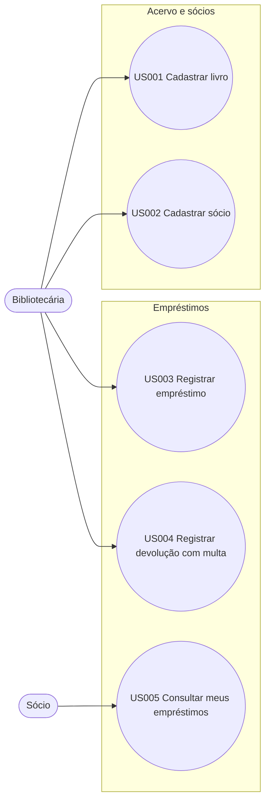

# Casos de uso: Biblioteca Comunitária

## Catálogo de casos de uso

Cada user story é detalhada como caso de uso: pré-condições e fluxo principal vêm dos critérios BDD; exceções vêm dos critérios EARS. Gerado automaticamente a partir da especificação.

**Atores e seus casos de uso**

| Ator | Casos de uso |
|---|---|
| Bibliotecária | UC-01 Cadastrar livro UC-02 Cadastrar sócio UC-03 Registrar empréstimo UC-04 Registrar devolução com multa |
| Sócio | UC-05 Consultar meus empréstimos |

### Diagrama de casos de uso

### UC-01 · Cadastrar livro (US001)

| Campo | Detalhe |
|---|---|
| Ator primário | Bibliotecária |
| Objetivo | cadastrar livros no acervo para controlar quais títulos estão disponíveis |
| Prioridade / MVP | Must / sim |
| Pré-condições | a bibliotecária está autenticada |
| Fluxo principal | **AC001.1** Quando informa título, autor e código do livro e confirma → Então o livro aparece na lista do acervo com status "disponível" |
| Fluxos alternativos e exceções | **AC001.2** Se o código informado já existir no acervo, então o sistema deve recusar o cadastro e exibir a mensagem "Código já cadastrado". |
| Pós-condições | o livro aparece na lista do acervo com status "disponível" |
| Regras de negócio | — |
| Critérios de aceite | AC001.1, AC001.2 |
| Origem | intake ("A bibliotecária cadastra os livros") e A001 |

### UC-02 · Cadastrar sócio (US002)

| Campo | Detalhe |
|---|---|
| Ator primário | Bibliotecária |
| Objetivo | cadastrar sócios para registrar quem pode pegar livros emprestados |
| Prioridade / MVP | Must / sim |
| Pré-condições | a bibliotecária está autenticada |
| Fluxo principal | **AC002.1** Quando informa nome e telefone do sócio e confirma → Então o sistema gera um número de carteirinha único e exibe o sócio como "ativo" |
| Fluxos alternativos e exceções | — |
| Pós-condições | o sistema gera um número de carteirinha único e exibe o sócio como "ativo" |
| Regras de negócio | — |
| Critérios de aceite | AC002.1 |
| Origem | intake ("e os sócios") |

### UC-03 · Registrar empréstimo (US003)

| Campo | Detalhe |
|---|---|
| Ator primário | Bibliotecária |
| Objetivo | registrar o empréstimo de um livro a um sócio para controlar prazos e disponibilidade |
| Prioridade / MVP | Must / sim |
| Pré-condições | o livro está disponível e o sócio possui menos de 3 empréstimos ativos |
| Fluxo principal | **AC003.1** Quando a bibliotecária registra o empréstimo → Então o livro passa a "emprestado" e a data de vencimento é a data atual mais 14 dias |
| Fluxos alternativos e exceções | **AC003.2** Se o sócio já possuir 3 empréstimos ativos, então o sistema deve impedir o novo empréstimo e informar o limite. **AC003.3** Se o livro estiver com status "emprestado", então o sistema deve impedir o empréstimo e informar a data prevista de devolução. |
| Pós-condições | o livro passa a "emprestado" e a data de vencimento é a data atual mais 14 dias |
| Regras de negócio | **RN001** O prazo de empréstimo é de 14 dias corridos. **RN002** Cada sócio pode ter no máximo 3 empréstimos ativos. |
| Critérios de aceite | AC003.1, AC003.2, AC003.3 |
| Origem | intake ("registra o empréstimo, com prazo de 14 dias") |

### UC-04 · Registrar devolução com multa (US004)

| Campo | Detalhe |
|---|---|
| Ator primário | Bibliotecária |
| Objetivo | registrar a devolução e calcular a multa de atraso para liberar o livro e cobrar o valor devido |
| Prioridade / MVP | Must / sim |
| Pré-condições | existe um empréstimo ativo vencido há 4 dias |
| Fluxo principal | **AC004.1** Quando a bibliotecária registra a devolução → Então o livro volta a "disponível" e o sistema exibe multa de R$ 2,00 |
| Fluxos alternativos e exceções | **AC004.2** Quando a devolução ocorrer até a data de vencimento, o sistema deve concluir a devolução sem multa. |
| Pós-condições | o livro volta a "disponível" e o sistema exibe multa de R$ 2,00 |
| Regras de negócio | **RN003** A multa é de R$ 0,50 por dia corrido de atraso, sem teto. |
| Critérios de aceite | AC004.1, AC004.2 |
| Origem | intake ("cobra multa de 50 centavos por dia de atraso") e Q001 |

### UC-05 · Consultar meus empréstimos (US005)

| Campo | Detalhe |
|---|---|
| Ator primário | Sócio |
| Objetivo | consultar meus empréstimos e vencimentos pelo celular para devolver os livros no prazo |
| Prioridade / MVP | Should / não |
| Pré-condições | o sócio informa seu número de carteirinha |
| Fluxo principal | **AC005.1** Quando abre a consulta → Então vê a lista de livros emprestados com a data de vencimento de cada um |
| Fluxos alternativos e exceções | — |
| Pós-condições | vê a lista de livros emprestados com a data de vencimento de cada um |
| Regras de negócio | — |
| Critérios de aceite | AC005.1 |
| Origem | intake ("consultar pelo celular o que está com ele") e A002 |

