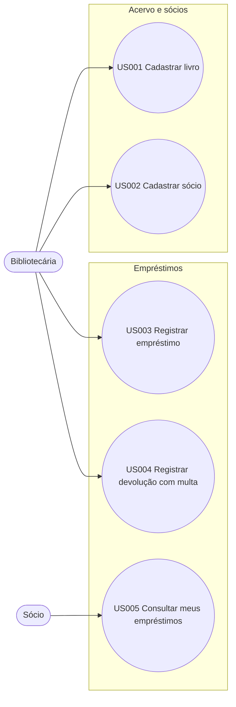
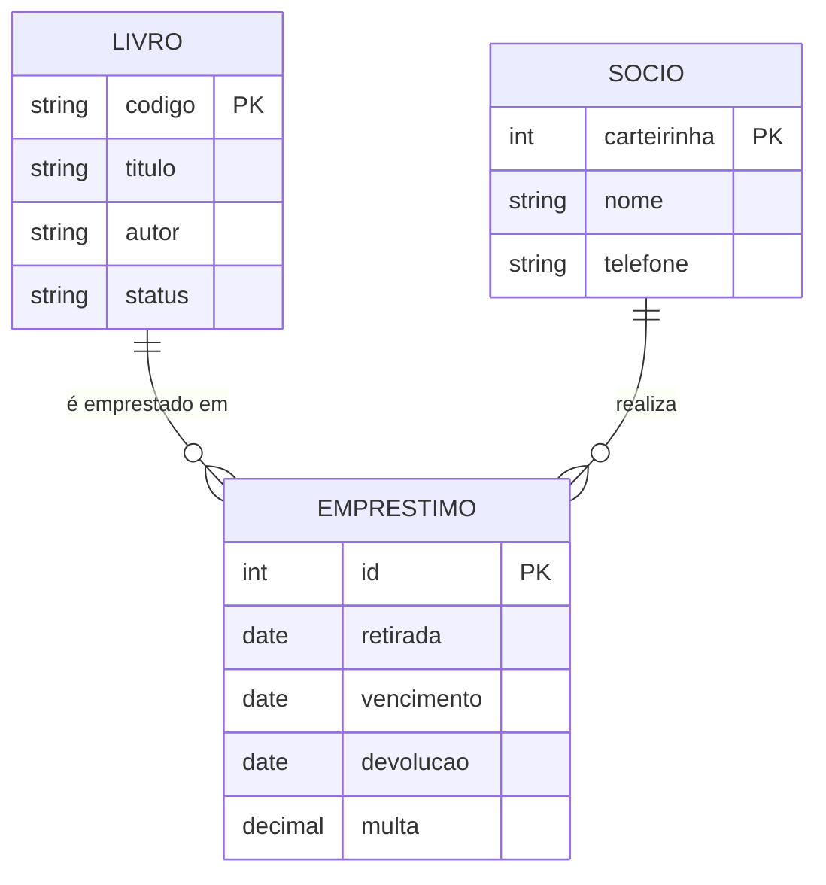
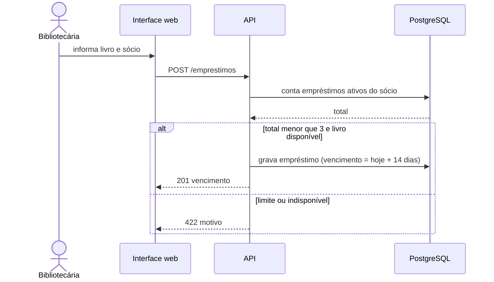

# Diagramas UML: Biblioteca Comunitária

## Casos de uso

_Cobre: US001, US002, US003, US004, US005_

## Modelo ER

_Cobre: US001, US002, US003, RN002_

## Sequência: emprestimo

_Cobre: US003, RN001, RN002_

