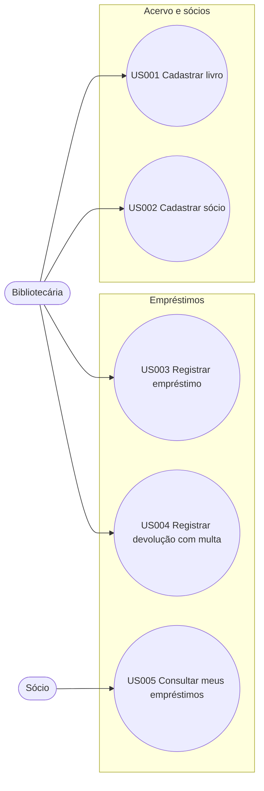
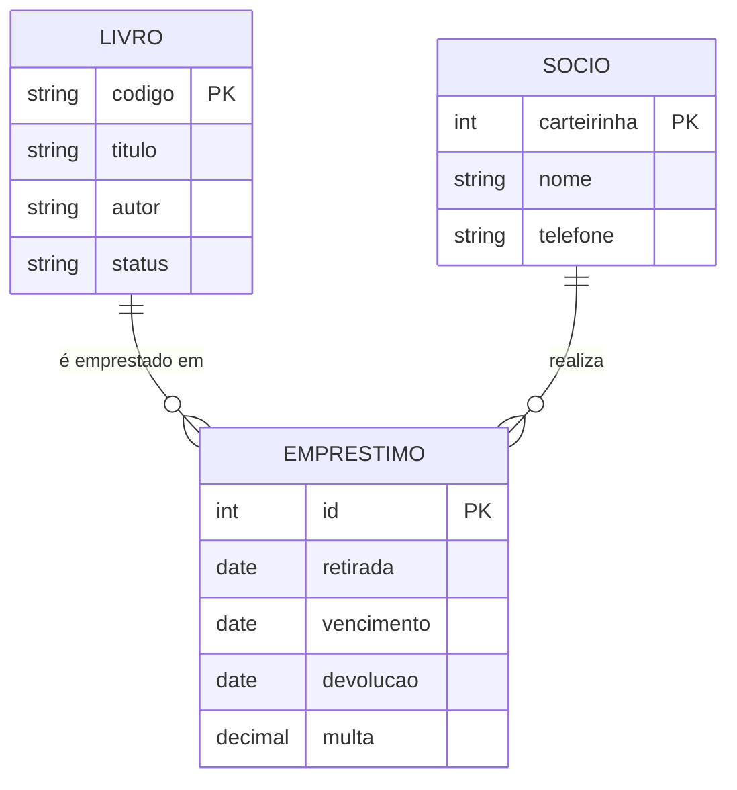
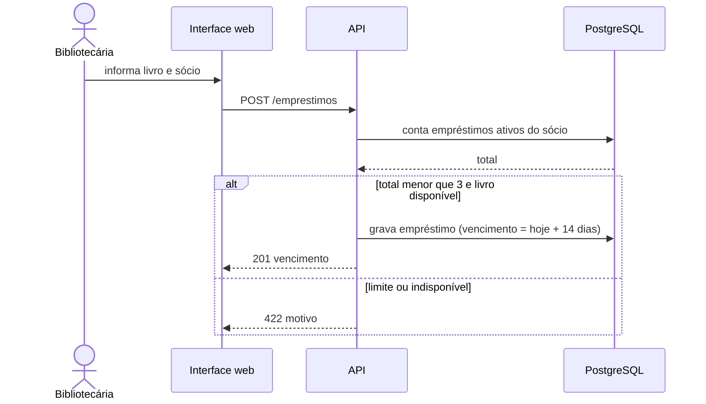

# Biblioteca Comunitária

**Documento de Especificação do Sistema**

| Campo | Valor |
|---|---|
| Projeto | Biblioteca Comunitária |
| Modo | greenfield |
| Metodologia | scrum |
| Tamanho | pequeno |
| Gerado em | 2026-10-20 |
| Versão da spec | f49bc004 |
| Status de validação | Aprovado no gate 6 |

## Sumário

1. [Visão geral](#visão-geral)
2. [Stack e decisões arquiteturais](#stack-e-decisões-arquiteturais)
3. [Requisitos](#requisitos)
4. [Casos de uso](#casos-de-uso)
5. [Design e UML](#design-e-uml)
6. [Planejamento](#planejamento)
7. [Plano de testes](#plano-de-testes)
8. [Rastreabilidade](#rastreabilidade)
9. [Glossário](#glossário)
10. [Pendências e suposições](#pendências-e-suposições)

## Visão geral

### Resumo
Sistema web simples para a biblioteca de um bairro controlar o acervo, os sócios, os empréstimos (prazo de 14 dias, limite de 3 livros) e a multa por atraso, com consulta do sócio pelo celular.

### Atores
| Ator | Descrição | Objetivos |
|---|---|---|
| Bibliotecária | Operadora do sistema | Controlar acervo, sócios e empréstimos |
| Sócio | Frequentador cadastrado | Consultar seus empréstimos |

### Escopo
#### Dentro
Cadastro de livros e sócios, empréstimo, devolução com multa, consulta do sócio.
#### Fora
Reservas, pagamento online da multa, integração com catálogo externo.

### Dimensionamento
- **Tamanho proposto:** pequeno (5 US, sem integrações, sem compliance regulatório)

## Stack e decisões arquiteturais

Prioridade: manutenibilidade, custo, time_to_market. Equipe de 3 pessoas que já domina Python e Postgres.

| Camada | Escolha | ADR | Alternativas rejeitadas |
|---|---|---|---|
| banco | postgres | ADR-001 | mysql, mongodb |

### ADR-001: Banco relacional (PostgreSQL)
- **Status:** aceita
- **Data:** 2026-10-19
- **Verificado em:** 2026-10-19
- **Camada:** banco

#### Contexto
Dados relacionais (livros, sócios, empréstimos) e regras transacionais (RN002).

#### Decisão
PostgreSQL, que o time já domina.

#### Alternativas consideradas
| Alternativa | Motivo da rejeição |
|---|---|
| MongoDB | dados fortemente relacionais |

#### Consequências
- Positivas: transações e integridade referencial.
- Negativas: nenhuma relevante para a escala prevista.

#### Tasks geradas
TSK001

### ADR-002: Django + DRF
- **Status:** aceita
- **Data:** 2026-10-19
- **Verificado em:** 2026-10-19
- **Camada:** backend

#### Contexto
Time domina Python e o Django entrega admin, ORM e migrações prontas.

#### Decisão
Django + DRF.

#### Alternativas consideradas
| Alternativa | Motivo da rejeição |
|---|---|
| ver analise.md | escopo pequeno e equipe reduzida |

#### Consequências
- Positivas: entrega rápida.
- Negativas: revisar a escolha se o escopo crescer para grande.

#### Tasks geradas
TSK001

### ADR-003: PaaS gerenciado
- **Status:** aceita
- **Data:** 2026-10-19
- **Verificado em:** 2026-10-19
- **Camada:** infra

#### Contexto
Time de 3 pessoas sem perfil de operação; prioriza time-to-market e custo baixo.

#### Decisão
PaaS gerenciado.

#### Alternativas consideradas
| Alternativa | Motivo da rejeição |
|---|---|
| ver analise.md | escopo pequeno e equipe reduzida |

#### Consequências
- Positivas: entrega rápida.
- Negativas: revisar a escolha se o escopo crescer para grande.

#### Tasks geradas
TSK001

## Requisitos

### EP001 · Acervo e sócios

#### US001 · Cadastrar livro

> Como bibliotecária, quero cadastrar livros no acervo para controlar quais títulos estão disponíveis.

| Prioridade | MVP | Regras | NFR | Origem |
|---|---|---|---|---|
| Must | sim | — | RNF002 | intake ("A bibliotecária cadastra os livros") e A001 |

**Critérios de aceite**

- **AC001.1 (BDD):** _Dado que_ a bibliotecária está autenticada · _Quando_ informa título, autor e código do livro e confirma · _Então_ o livro aparece na lista do acervo com status "disponível"
- **AC001.2 (EARS):** Se o código informado já existir no acervo, então o sistema deve recusar o cadastro e exibir a mensagem "Código já cadastrado".

#### US002 · Cadastrar sócio

> Como bibliotecária, quero cadastrar sócios para registrar quem pode pegar livros emprestados.

| Prioridade | MVP | Regras | NFR | Origem |
|---|---|---|---|---|
| Must | sim | — | — | intake ("e os sócios") |

**Critérios de aceite**

- **AC002.1 (BDD):** _Dado que_ a bibliotecária está autenticada · _Quando_ informa nome e telefone do sócio e confirma · _Então_ o sistema gera um número de carteirinha único e exibe o sócio como "ativo"

### EP002 · Empréstimos

#### US003 · Registrar empréstimo

> Como bibliotecária, quero registrar o empréstimo de um livro a um sócio para controlar prazos e disponibilidade.

| Prioridade | MVP | Regras | NFR | Origem |
|---|---|---|---|---|
| Must | sim | RN001, RN002 | — | intake ("registra o empréstimo, com prazo de 14 dias") |

**Critérios de aceite**

- **AC003.1 (BDD):** _Dado que_ o livro está disponível e o sócio possui menos de 3 empréstimos ativos · _Quando_ a bibliotecária registra o empréstimo · _Então_ o livro passa a "emprestado" e a data de vencimento é a data atual mais 14 dias
- **AC003.2 (EARS):** Se o sócio já possuir 3 empréstimos ativos, então o sistema deve impedir o novo empréstimo e informar o limite.
- **AC003.3 (EARS):** Se o livro estiver com status "emprestado", então o sistema deve impedir o empréstimo e informar a data prevista de devolução.

#### US004 · Registrar devolução com multa

> Como bibliotecária, quero registrar a devolução e calcular a multa de atraso para liberar o livro e cobrar o valor devido.

| Prioridade | MVP | Regras | NFR | Origem |
|---|---|---|---|---|
| Must | sim | RN003 | — | intake ("cobra multa de 50 centavos por dia de atraso") e Q001 |

**Critérios de aceite**

- **AC004.1 (BDD):** _Dado que_ existe um empréstimo ativo vencido há 4 dias · _Quando_ a bibliotecária registra a devolução · _Então_ o livro volta a "disponível" e o sistema exibe multa de R$ 2,00
- **AC004.2 (EARS):** Quando a devolução ocorrer até a data de vencimento, o sistema deve concluir a devolução sem multa.

#### US005 · Consultar meus empréstimos

> Como sócio, quero consultar meus empréstimos e vencimentos pelo celular para devolver os livros no prazo.

| Prioridade | MVP | Regras | NFR | Origem |
|---|---|---|---|---|
| Should | não | — | RNF001 | intake ("consultar pelo celular o que está com ele") e A002 |

**Critérios de aceite**

- **AC005.1 (BDD):** _Dado que_ o sócio informa seu número de carteirinha · _Quando_ abre a consulta · _Então_ vê a lista de livros emprestados com a data de vencimento de cada um

### Regras de negócio

| ID | Regra |
|---|---|
| RN001 | O prazo de empréstimo é de 14 dias corridos. |
| RN002 | Cada sócio pode ter no máximo 3 empréstimos ativos. |
| RN003 | A multa é de R$ 0,50 por dia corrido de atraso, sem teto. |

### Requisitos não funcionais

| ID | Requisito |
|---|---|
| RNF001 | A consulta do sócio deve carregar em menos de 2 segundos no p95 em conexão 4G. |
| RNF002 | O acesso à área da bibliotecária exige autenticação com senha de no mínimo 10 caracteres. |

## Casos de uso

### Catálogo de casos de uso

Cada user story é detalhada como caso de uso: pré-condições e fluxo principal vêm dos critérios BDD; exceções vêm dos critérios EARS. Gerado automaticamente a partir da especificação.

**Atores e seus casos de uso**

| Ator | Casos de uso |
|---|---|
| Bibliotecária | UC-01 Cadastrar livro UC-02 Cadastrar sócio UC-03 Registrar empréstimo UC-04 Registrar devolução com multa |
| Sócio | UC-05 Consultar meus empréstimos |

#### Diagrama de casos de uso

#### UC-01 · Cadastrar livro (US001)

| Campo | Detalhe |
|---|---|
| Ator primário | Bibliotecária |
| Objetivo | cadastrar livros no acervo para controlar quais títulos estão disponíveis |
| Prioridade / MVP | Must / sim |
| Pré-condições | a bibliotecária está autenticada |
| Fluxo principal | **AC001.1** Quando informa título, autor e código do livro e confirma → Então o livro aparece na lista do acervo com status "disponível" |
| Fluxos alternativos e exceções | **AC001.2** Se o código informado já existir no acervo, então o sistema deve recusar o cadastro e exibir a mensagem "Código já cadastrado". |
| Pós-condições | o livro aparece na lista do acervo com status "disponível" |
| Regras de negócio | — |
| Critérios de aceite | AC001.1, AC001.2 |
| Origem | intake ("A bibliotecária cadastra os livros") e A001 |

#### UC-02 · Cadastrar sócio (US002)

| Campo | Detalhe |
|---|---|
| Ator primário | Bibliotecária |
| Objetivo | cadastrar sócios para registrar quem pode pegar livros emprestados |
| Prioridade / MVP | Must / sim |
| Pré-condições | a bibliotecária está autenticada |
| Fluxo principal | **AC002.1** Quando informa nome e telefone do sócio e confirma → Então o sistema gera um número de carteirinha único e exibe o sócio como "ativo" |
| Fluxos alternativos e exceções | — |
| Pós-condições | o sistema gera um número de carteirinha único e exibe o sócio como "ativo" |
| Regras de negócio | — |
| Critérios de aceite | AC002.1 |
| Origem | intake ("e os sócios") |

#### UC-03 · Registrar empréstimo (US003)

| Campo | Detalhe |
|---|---|
| Ator primário | Bibliotecária |
| Objetivo | registrar o empréstimo de um livro a um sócio para controlar prazos e disponibilidade |
| Prioridade / MVP | Must / sim |
| Pré-condições | o livro está disponível e o sócio possui menos de 3 empréstimos ativos |
| Fluxo principal | **AC003.1** Quando a bibliotecária registra o empréstimo → Então o livro passa a "emprestado" e a data de vencimento é a data atual mais 14 dias |
| Fluxos alternativos e exceções | **AC003.2** Se o sócio já possuir 3 empréstimos ativos, então o sistema deve impedir o novo empréstimo e informar o limite. **AC003.3** Se o livro estiver com status "emprestado", então o sistema deve impedir o empréstimo e informar a data prevista de devolução. |
| Pós-condições | o livro passa a "emprestado" e a data de vencimento é a data atual mais 14 dias |
| Regras de negócio | **RN001** O prazo de empréstimo é de 14 dias corridos. **RN002** Cada sócio pode ter no máximo 3 empréstimos ativos. |
| Critérios de aceite | AC003.1, AC003.2, AC003.3 |
| Origem | intake ("registra o empréstimo, com prazo de 14 dias") |

#### UC-04 · Registrar devolução com multa (US004)

| Campo | Detalhe |
|---|---|
| Ator primário | Bibliotecária |
| Objetivo | registrar a devolução e calcular a multa de atraso para liberar o livro e cobrar o valor devido |
| Prioridade / MVP | Must / sim |
| Pré-condições | existe um empréstimo ativo vencido há 4 dias |
| Fluxo principal | **AC004.1** Quando a bibliotecária registra a devolução → Então o livro volta a "disponível" e o sistema exibe multa de R$ 2,00 |
| Fluxos alternativos e exceções | **AC004.2** Quando a devolução ocorrer até a data de vencimento, o sistema deve concluir a devolução sem multa. |
| Pós-condições | o livro volta a "disponível" e o sistema exibe multa de R$ 2,00 |
| Regras de negócio | **RN003** A multa é de R$ 0,50 por dia corrido de atraso, sem teto. |
| Critérios de aceite | AC004.1, AC004.2 |
| Origem | intake ("cobra multa de 50 centavos por dia de atraso") e Q001 |

#### UC-05 · Consultar meus empréstimos (US005)

| Campo | Detalhe |
|---|---|
| Ator primário | Sócio |
| Objetivo | consultar meus empréstimos e vencimentos pelo celular para devolver os livros no prazo |
| Prioridade / MVP | Should / não |
| Pré-condições | o sócio informa seu número de carteirinha |
| Fluxo principal | **AC005.1** Quando abre a consulta → Então vê a lista de livros emprestados com a data de vencimento de cada um |
| Fluxos alternativos e exceções | — |
| Pós-condições | vê a lista de livros emprestados com a data de vencimento de cada um |
| Regras de negócio | — |
| Critérios de aceite | AC005.1 |
| Origem | intake ("consultar pelo celular o que está com ele") e A002 |

## Design e UML

Aplicação web monolítica com API REST e interface responsiva. Banco PostgreSQL (ADR-001).
### Diagramas
- `er.mmd`: modelo de dados
- `sequencia-emprestimo.mmd`: fluxo de registro de empréstimo

### Diagramas UML

#### Casos de uso

_Cobre: US001, US002, US003, US004, US005_

#### Modelo ER

_Cobre: US001, US002, US003, RN002_

#### Sequência: emprestimo

_Cobre: US003, RN001, RN002_

## Planejamento

### Tasks

**9 tasks · 32 (pontos/dias) no total.** Caminho crítico: TSK001 → TSK002 → TSK003 → TSK006 → TSK007 → TSK008 (24).

| ID | Título | Tipo | Est. | Depende de | Refs |
|---|---|---|---|---|---|
| TSK001 | Preparar repositório, CI e deploy em PaaS | devops | 5 | — | ADR-001, RNF002 |
| TSK002 | Modelar e migrar tabelas livro, sócio e empréstimo | dados | 3 | TSK001 | US001, US002, US003, AC001.1 |
| TSK003 | API de cadastro de livros | backend | 3 | TSK002 | US001, AC001.1, AC001.2 |
| TSK004 | Autenticação da bibliotecária | seguranca | 3 | TSK001 | RNF002, US001 |
| TSK005 | API de cadastro de sócios | backend | 2 | TSK002 | US002, AC002.1 |
| TSK006 | API de empréstimo com regras de prazo e limite | backend | 5 | TSK003, TSK005 | US003, AC003.1, AC003.2, AC003.3, RN001, RN002 |
| TSK007 | API de devolução e cálculo de multa | backend | 3 | TSK006 | US004, AC004.1, AC004.2, RN003 |
| TSK008 | Telas da bibliotecária (livros, sócios, empréstimo, devolução) | frontend | 5 | TSK006, TSK007 | US001, US002, US003, US004 |
| TSK009 | Consulta de empréstimos do sócio (mobile) | frontend | 3 | TSK006 | US005, AC005.1, RNF001 |

Distribuição por tipo: backend 13, dados 3, devops 5, frontend 8, seguranca 3

### Plano Scrum

Velocidade assumida: 20 pts/sprint (sprints de 2 semanas, equipe de 3).
| Sprint | Meta | Tasks | Pontos |
|---|---|---|---|
| 1 | Fundação e cadastros | TSK001, TSK002, TSK003, TSK004, TSK005 | 16 |
| 2 | Empréstimo, devolução e telas | TSK006, TSK007, TSK008, TSK009 | 16 |

### Riscos

| ID | Risco | Probabilidade | Impacto | Mitigação | Dono |
|---|---|---|---|---|---|
| RSK001 | Concorrência no registro de empréstimo do mesmo livro. | média | médio | transação com bloqueio; caso de teste de concorrência (TSK006) | tech lead |

## Plano de testes

| Caso | Título | Cobre | Nível | Resultado esperado |
|---|---|---|---|---|
| CT001.1.1 | Cadastro de livro válido | AC001.1 | integração | livro listado com status "disponível" |
| CT001.2.1 | Código de livro duplicado | AC001.2 | integração | recusa com mensagem "Código já cadastrado" |
| CT002.1.1 | Cadastro de sócio gera carteirinha única | AC002.1 | integração | carteirinha distinta para dois cadastros consecutivos |
| CT003.1.1 | Empréstimo válido define vencimento em 14 dias | AC003.1 | integração | vencimento igual à data atual mais 14 dias |
| CT003.2.1 | Quarto empréstimo é recusado | AC003.2 | integração | recusa informando o limite de 3 |
| CT003.3.1 | Livro já emprestado é recusado | AC003.3 | integração | recusa informando a data prevista de devolução |
| CT004.1.1 | Devolução com 4 dias de atraso | AC004.1 | unitário | multa de R$ 2,00 e livro disponível |
| CT004.2.1 | Devolução no prazo | AC004.2 | unitário | sem multa |
| CT005.1.1 | Consulta do sócio lista vencimentos | AC005.1 | E2E | lista com título e vencimento de cada empréstimo ativo |

## Rastreabilidade

| US | AC | Tasks | Casos de teste |
|---|---|---|---|
| US001 | AC001.1 | TSK002, TSK003 | CT001.1.1 |
| US001 | AC001.2 | TSK003 | CT001.2.1 |
| US002 | AC002.1 | TSK005 | CT002.1.1 |
| US003 | AC003.1 | TSK006 | CT003.1.1 |
| US003 | AC003.2 | TSK006 | CT003.2.1 |
| US003 | AC003.3 | TSK006 | CT003.3.1 |
| US004 | AC004.1 | TSK007 | CT004.1.1 |
| US004 | AC004.2 | TSK007 | CT004.2.1 |
| US005 | AC005.1 | TSK009 | CT005.1.1 |

## Glossário

| Termo | Definição | Não confundir com |
|---|---|---|
| Sócio | Pessoa cadastrada que pode pegar livros emprestados | Visitante |
| Empréstimo | Retirada de um exemplar por um sócio com prazo de devolução | Reserva |

## Pendências e suposições

### Perguntas

| ID | Pergunta | Impacto | Status | Resposta |
|---|---|---|---|---|
| Q001 | A multa tem teto máximo por empréstimo? | importante | respondida | Sem teto no MVP. |
| Q002 | Sócio com multa pendente pode pegar novo livro? | importante | aberta | — |
| Q003 | Qual a política de retenção e exclusão dos dados pessoais dos sócios (nome e telefone)? | importante | aceita-risco | — |

### Suposições

| ID | Suposição | Confiança | Se falsa | Validar com |
|---|---|---|---|---|
| A001 | Cada título possui um único exemplar físico. | média | modelo de dados precisa separar título e exemplar | bibliotecária |
| A002 | O sócio se identifica na consulta pelo número da carteirinha. | média | inclui autenticação por e-mail ou telefone | bibliotecária |

### Lacunas aceitas

Pendências que seguem sem resposta por decisão de um usuário autorizado.

| Lacuna | Impacto | Aceito por | Justificativa | Artefatos afetados |
|---|---|---|---|---|
| Q003: retenção e exclusão de dados pessoais | importante | Bibliotecária (responsável pelo projeto) | MVP de uso interno; a política será definida antes de abrir a consulta do sócio ao público | US002, modelo de dados |

### Aprovação do Discovery

Resumo aprovado por **Bibliotecária (responsável pelo projeto)** em 2026-10-20.

